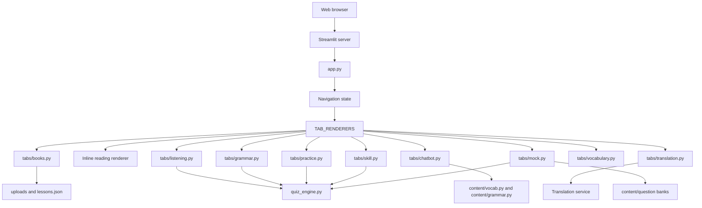
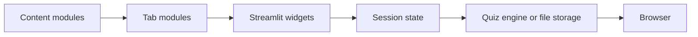
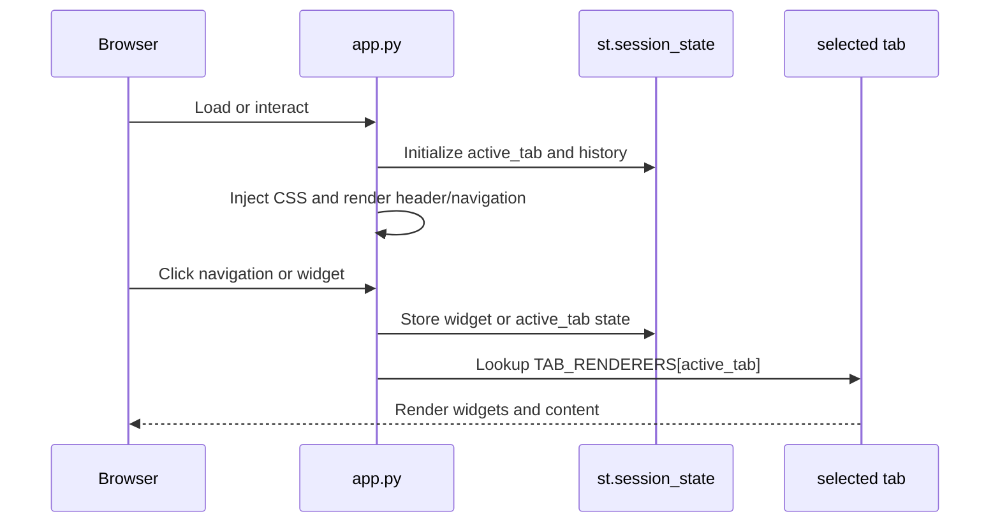
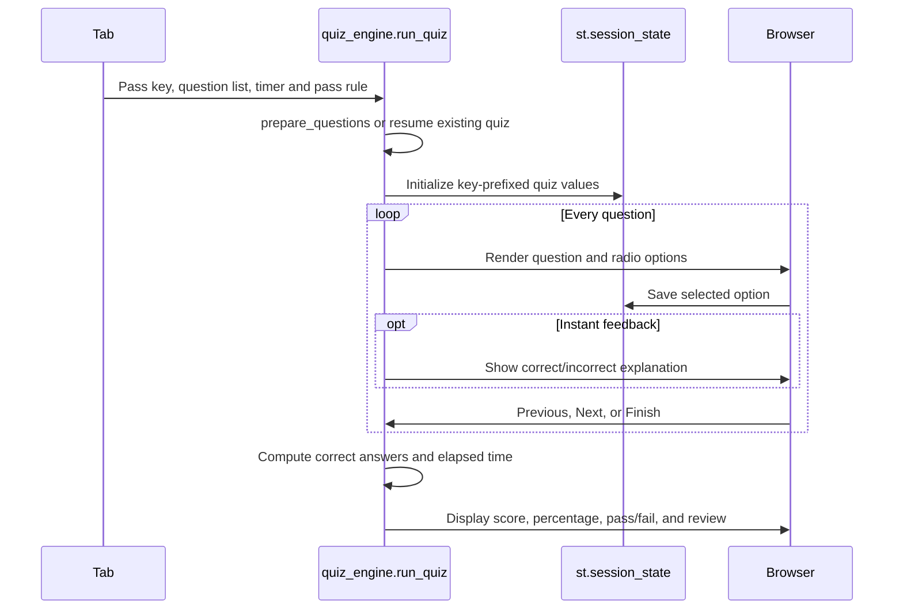
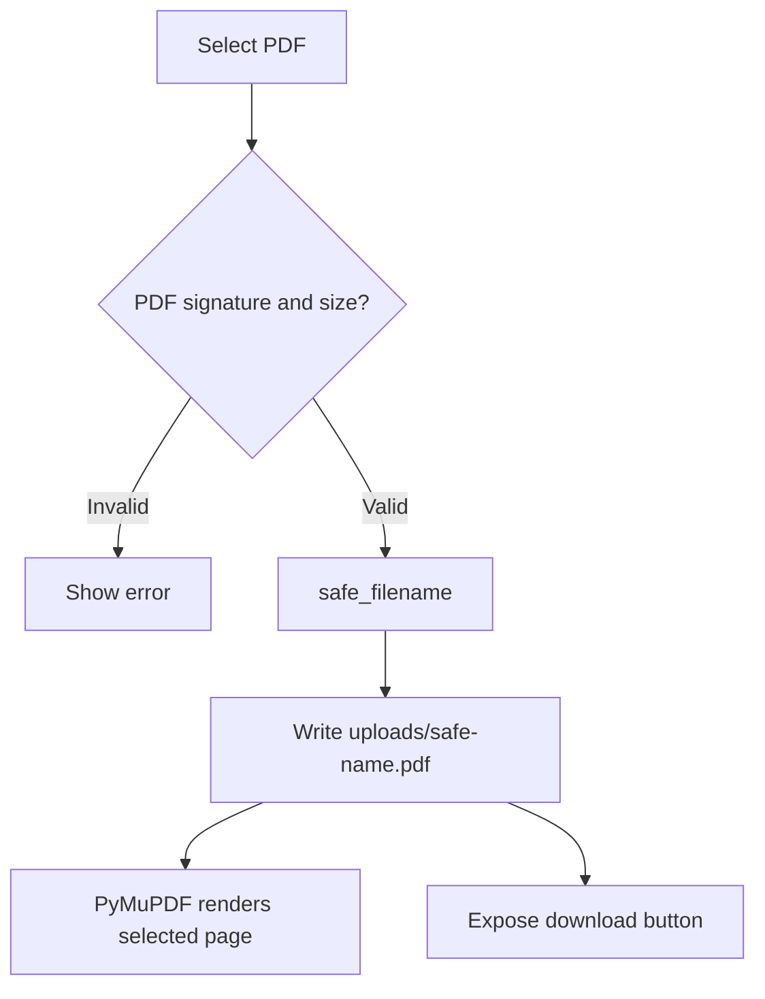
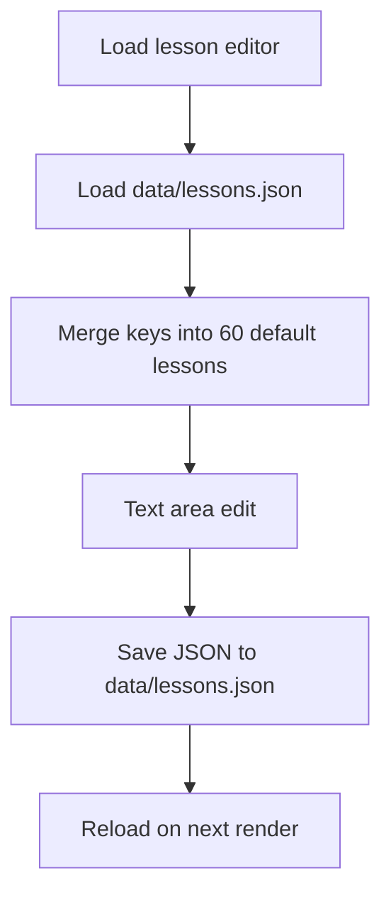
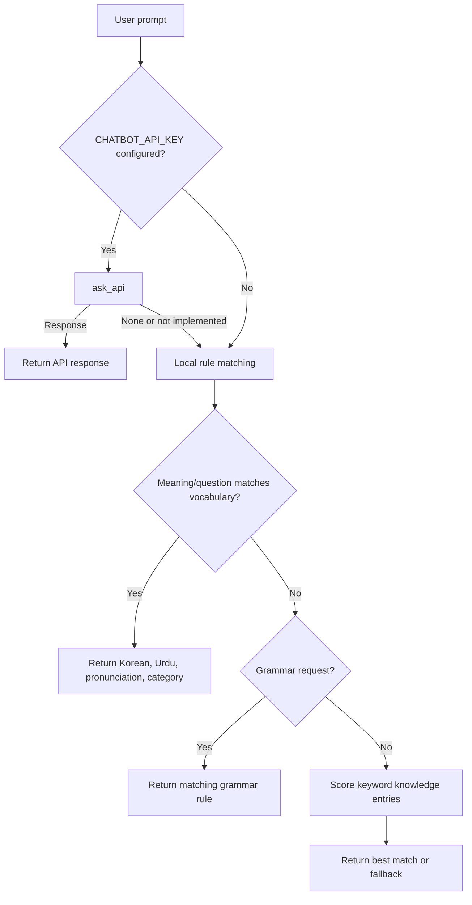

# KR KOREAN EPS-TOPIK PRO

A multilingual, dark-neon web application for Korean EPS-TOPIK preparation. It is built with Streamlit and provides vocabulary, grammar, listening, timed quizzes, PDF lesson management, translation, and a rule-based Korean assistant.

The interface and learning content include Korean, Urdu, and English. This repository is an educational prototype; it is not an official EPS-TOPIK application.

---

## Table of contents

1. [Screens and features](#screens-and-features)
2. [Technology stack](#technology-stack)
3. [Project structure](#project-structure)
4. [Architecture](#architecture)
5. [Application code flow](#application-code-flow)
6. [State and data model](#state-and-data-model)
7. [Local setup](#local-setup)
8. [Using the application](#using-the-application)
9. [Development guide](#development-guide)
10. [Adding or changing a feature](#adding-or-changing-a-feature)
11. [Testing](#testing)
12. [Debugging guide](#debugging-guide)
13. [Production and deployment considerations](#production-and-deployment-considerations)
14. [Known limitations](#known-limitations)

---

## Screens and features

| Screen | Behavior |
|---|---|
| EPS Topik Books | Upload and validate PDFs, save them under `uploads/`, download or preview them, and edit 60 named lesson entries in `data/lessons.json`. |
| Reading | Displays a small inline reading-choice example. |
| Listening | Runs 10 listening MCQs, plays real audio when supplied, and otherwise generates a placeholder WAV. |
| Grammar | Searches 20 Korean grammar rules and runs a 10-question grammar quiz. |
| Practice Quiz | Runs 20 questions with a 20-minute timer and a 60% pass threshold. |
| Chatbot | Uses local keyword, vocabulary, and grammar matching. An optional external LLM hook exists. |
| Translation | Translates between Korean, Urdu, and English through `deep-translator`. |
| Skill Test | Offers Easy, Medium, and Hard banks of 10 questions with 60%, 70%, and 80% pass thresholds. |
| Vocabulary | Searches and filters 100 words by Korean text, Urdu text, pronunciation, or category. |
| Mock Test | Creates a 25-question random test from the combined question pools and applies a 25-minute timer. |

---

## Technology stack

### Runtime

- **Python** for application and data logic
- **Streamlit** for the server-rendered UI, widgets, session state, and reruns
- **PyMuPDF (`fitz`)** for server-side PDF rendering
- **deep-translator** for Google translation API access
- **Python `wave`, `struct`, `random`, `time`, `json`, and `pathlib`** for audio generation, quiz preparation, timers, and storage

### Frontend

- Streamlit widgets render the interactive interface.
- Shared and page-specific CSS is injected through Python and `st.markdown(..., unsafe_allow_html=True)`.
- Google Fonts are requested for Orbitron, Rajdhani, and Noto Nastaliq Urdu.
- `script.js` is present, but it is not imported by the current Streamlit application.

### Data and persistence

The project does not use a database.

- Python constants in `content/` are read-only data sources.
- Lesson text is persisted to `data/lessons.json`.
- Uploaded PDFs are persisted to `uploads/<safe filename>.pdf`.
- Listening recordings are read from `data/audio/`.
- User selections and quiz progress are kept in Streamlit session state.

---

## Project structure

```text
KOREAN-EPS-TOPIC/
├── app.py                 # Entry point, page configuration, CSS, navigation, tab routing
├── ui.py                  # Shared CSS and section-heading helpers
├── quiz_engine.py         # Shared quiz lifecycle, timer, audio, answers, score, and review
├── script.js              # Legacy standalone JavaScript; not loaded by app.py
├── requirements.txt       # Python dependencies
├── tests/
│   └── test_app.py        # Streamlit AppTest and logic tests
├── content/
│   ├── __init__.py
│   ├── vocab.py           # 100 vocabulary records
│   ├── grammar.py         # 20 grammar rules and grammar quiz
│   └── questions.py       # Listening, practice, and skill question banks
├── tabs/
│   ├── __init__.py
│   ├── books.py           # PDF and lesson management
│   ├── chatbot.py         # Local chatbot and optional API hook
│   ├── grammar.py         # Grammar rule and quiz screen
│   ├── listening.py       # Listening quiz configuration
│   ├── mock.py            # Random timed mock test
│   ├── practice.py        # Timed practice test
│   ├── skill.py           # Easy/Medium/Hard skill test
│   ├── translation.py     # Translation screen
│   └── vocabulary.py      # Searchable vocabulary table
├── data/
│   └── audio/             # Optional listening_1.mp3 … listening_10.mp3 files
├── uploads/               # Runtime PDF storage
└── README.md
```

Directories such as `data/`, `data/audio/`, `uploads/`, and `data/lessons.json` may be absent or empty in a clean checkout and are created when the corresponding feature is used.

---

## Architecture

### Component architecture



### Responsibilities

- `app.py` owns global page setup, navigation state, shared CSS, and the tab-to-renderer mapping.
- `ui.py` owns reusable visual styles and heading helpers.
- `tabs/` owns screen-specific behavior.
- `quiz_engine.py` owns reusable quiz state, questions, timers, answer checks, scoring, review, and reset behavior.
- `content/` owns static lesson data and question records.
- Runtime storage is isolated in `uploads/` and `data/`.

### Separation of concerns



Static question and learning content should remain in `content/`. Screen interaction should remain in `tabs/`. Reusable quiz behavior should remain in `quiz_engine.py`. Do not put large datasets directly into `app.py`.

---

## Application code flow

### Startup and reruns

Every Streamlit rerun executes `app.py` again. Navigation buttons update `st.session_state.active_tab`, after which the selected renderer is invoked.



### Quiz flow



`prepare_questions()` preserves the original correct text while deterministically or randomly shuffling option indices. It can select a random subset for the mock test.

### PDF flow



### Lesson editor flow



### Chatbot flow



---

## State and data model

### Session state

Important global keys include:

| Key | Purpose |
|---|---|
| `active_tab` | Name of the currently rendered screen |
| `book_sub_action` | Selected Books subsection: upload, download, or edit |
| `chat_history` | Chatbot conversation |
| `last_book` | Most recently uploaded PDF path |

Each quiz uses prefixed keys derived from `_k(key, name)`:

- `<key>__qs`: shuffled question dictionaries
- `<key>__idx`: current question index
- `<key>__answers`: selected answer index by question index
- `<key>__checked`: questions with instant feedback already checked
- `<key>__done`: whether the result screen should be shown
- `<key>__start`: quiz start time
- `<key>__radio<number>`: Streamlit radio widget state

Examples: `practice__idx`, `listening__answers`, `skill_hard__start`, and `mock__done`.

### Question tuple format

```python
(question, options, correct_option_index, explanation)
```

Listening questions add an audio transcript:

```python
(question, options, correct_option_index, explanation, transcript)
```

### Vocabulary tuple format

```python
(korean, urdu, pronunciation, category)
```

### Grammar tuple format

```python
(title, pattern, korean_example, urdu_example, urdu_explanation)
```

---

## Local setup

### Requirements

- Python 3.10 or newer is recommended.
- Internet access is required for translation and Google Fonts.
- A virtual environment is recommended.

### Windows PowerShell

```powershell
cd "D:\My Aaps\KOREAN-EPS-TOPIC"

py -m venv .venv
.\.venv\Scripts\Activate.ps1
python -m pip install --upgrade pip
python -m pip install -r requirements.txt
streamlit run app.py
```

If script activation is blocked:

```powershell
Set-ExecutionPolicy -Scope Process -ExecutionPolicy Bypass
.\.venv\Scripts\Activate.ps1
```

### macOS/Linux

```bash
python3 -m venv .venv
source .venv/bin/activate
python -m pip install --upgrade pip
python -m pip install -r requirements.txt
streamlit run app.py
```

Streamlit normally opens `http://localhost:8501`.

### Optional listening audio

Create `data/audio/` and add files named:

```text
listening_1.mp3
listening_2.mp3
...
listening_10.mp3
```

`.wav` and `.ogg` files with the same naming pattern are also recognized.

Without a matching file, `quiz_engine.make_beep_wav()` produces a playable placeholder tone.

### Optional chatbot API

Set `CHATBOT_API_KEY` to activate the future API branch in `tabs/chatbot.py`:

```powershell
$env:CHATBOT_API_KEY = "your-key"
streamlit run app.py
```

The current implementation intentionally returns `None`, so the application remains on local rule-based answers until `ask_api()` is implemented. Do not place API keys in source code or commit a `.env` file.

---

## Using the application

1. Start Streamlit with `streamlit run app.py`.
2. Use the top navigation buttons to select a feature.
3. Quizzes support previous, next, finish, instant answer feedback, timed result screens, and review.
4. The Practice, Skill, Grammar, Listening, and Mock screens share `quiz_engine.run_quiz()`.
5. PDF uploads are saved in `uploads/`; lesson edits are saved in `data/lessons.json`.
6. Browser reload or Streamlit session reset clears in-memory quiz state.

---

## Development guide

### Safe change patterns

- Keep content records in `content/`.
- Keep tab UI code in `tabs/<feature>.py`.
- Use `heading()` and `subheading()` from `ui.py` for consistency.
- Reuse `run_quiz()` for all MCQ quizzes.
- Use unique quiz keys. Changing a key changes the session-state namespace.
- Preserve tuple shapes used by `prepare_questions()`.
- Clean up state by using `reset_quiz()` or removing all `<key>__` keys.
- Add new data directories at runtime, not during module import, unless they are essential.
- Keep file operations relative to `Path(__file__)` so paths remain stable.

### Naming conventions

- Use a stable snake-case quiz key, such as `"practice"` or `"grammar_quiz"`.
- Use tab render functions named `render()`.
- Keep state keys self-prefixed to avoid collisions.
- Add public helper functions in a tab module when Streamlit AppTest can test them directly.

---

## Adding or changing a feature

### Add a vocabulary or grammar entry

1. Update `content/vocab.py` or `content/grammar.py`.
2. Follow the existing tuple shape.
3. Add or update a count/filter test in `tests/test_app.py`.
4. Run the smallest relevant test first.

### Add a question bank

1. Add a tuple list in `content/questions.py`.
2. Import it in the relevant `tabs/*.py`.
3. Call `run_quiz()` with a unique key.
4. Choose the timer, pass threshold, audio, and feedback options explicitly.
5. Add an AppTest flow for navigation and finishing.

### Add a complete tab

1. Create `tabs/<name>.py` with a `render()` function.
2. Import it in `app.py`.
3. Add a navigation button and set `st.session_state.active_tab`.
4. Add the tab name and `render` function to `TAB_RENDERERS`.
5. Add a navigation test and a targeted behavior test.

### Replace the chatbot logic

Keep `get_reply()` as the stable tab-facing function. Implement provider code inside `ask_api()` and retain the existing local fallback. Never pass secret values or chat history into the browser through rendered HTML.

### Change quiz behavior

Modify `quiz_engine.py`, then run:

- the shuffle test,
- listening feedback test,
- practice result test,
- skill pass/fail test,
- grammar quiz test,
- mock test test.

Because all quizzes share this engine, a change can affect several tabs.

---

## Testing

### Run the test script

```powershell
python tests/test_app.py
```

### Run with pytest

```powershell
python -m pip install pytest
python -m pytest tests/test_app.py -v
```

The suite covers content counts and tuple consistency, option shuffling, vocabulary filtering, chatbot matching, lesson and upload storage, tab rendering, listening feedback, quiz results, skill thresholds, mock test size, grammar search, and translation empty-input handling.

### Test a single behavior

The script exposes individual functions. For pytest, for example:

```powershell
python -m pytest tests/test_app.py -k "vocab_filter or chatbot_replies" -v
```

When debugging quiz state manually, use Streamlit AppTest if possible because it observes session state and widget reruns without requiring a browser.

---

## Debugging guide

### The app does not start

1. Activate the virtual environment.
2. Verify Streamlit is in the environment:

   ```powershell
   python -m pip show streamlit
   ```

3. Reinstall requirements:

   ```powershell
   python -m pip install -r requirements.txt
   ```

4. Run with a visible traceback:

   ```powershell
   streamlit run app.py --server.runOnSave true
   ```

### A tab is blank or throws a rerun exception

1. Open the terminal running Streamlit and read the traceback.
2. Confirm `app.py` has the tab name in `TAB_RENDERERS`.
3. Confirm the tab module imports a working `render()` function.
4. Run `python tests/test_app.py` to identify whether it is a global render or widget issue.

### Navigation is incorrect

Check `active_tab` and button keys in `app.py`. Navigation keys are stable names:

```text
nav_btn1 ... nav_btn10
```

Do not change these keys without updating tests.

### Quiz answers or scores are wrong

Check the following in order:

1. `raw_questions` tuple shape.
2. `correct_option_index` in the original tuple.
3. `prepare_questions()` shuffling.
4. `<key>__answers`.
5. `compute_score()`.

Useful invariant:

```text
answer index after shuffle == index of the original correct answer text
```

Use `prepare_questions(raw, seed=<value>)` while debugging to reproduce the same shuffle.

### Quiz state is stale

Unique state keys are essential. Call `reset_quiz("<key>")` or stop and clear the Streamlit session. If a data structure changed but old session keys remain, reset the browser session or change the quiz key.

For example, changing practice data usually does not require a new key, but changing a quiz structure or test version may benefit from a versioned key such as `"practice_v2"`.

### Timer does not end or shows stale time

The timer uses `_k(key, "start")` and wall-clock `time.time()`. Investigate these values if it behaves unexpectedly:

- confirm `_k(key, "done")` is not already `True`,
- confirm the start key exists,
- confirm `_timer()` has not been removed by navigation,
- confirm Streamlit fragments are supported by the installed Streamlit version.

### Listening audio is missing

Place recordings in `data/audio/` with the exact quiz key and question number:

```text
listening_1.mp3
...
listening_10.mp3
```

The player falls back to a generated beep and caption if no file exists.

### PDF preview fails

Check:

1. Whether the file really starts with `%PDF`.
2. Whether `PyMuPDF` is installed.
3. Whether the PDF is encrypted or corrupt.
4. Whether the selected page number is within the file.

`safe_filename()` removes path components and unsafe characters. If a download has an unexpected name, inspect this helper.

### Lesson changes do not persist

Check write permissions on the project directory and inspect `data/lessons.json`. `save_lessons()` creates the parent directory. A malformed existing JSON file is treated as a read failure and falls back to 60 empty lessons.

### Translation fails

Translation is network-dependent. Check:

- internet access,
- `deep-translator` installation,
- the 4500-character limit,
- source/target direction,
- Google service availability or rate limits.

The UI should surface friendly errors for empty text and runtime/network failures.

### Chatbot gives the fallback

Try one of the documented prompt formats:

```text
meaning of 학교
explain 에서
EPS exam kya hai
study tips
numbers
```

If a word or rule is not matched, verify that `_lookup_word()` and `_lookup_rule()` receive the current Korean text exactly and that the relevant content exists.

### Streamlit session values grow or widgets collide

Inspect all keys from `st.session_state` in a temporary debug location. Prefix every quiz key, radio key, and tab-specific key. Remove old keys by identifying them with `reset_quiz()` or a controlled loop that starts with the same known prefix.

### Python import or module issues

From the project root, run:

```powershell
python -c "import app"
```

For isolated functions:

```powershell
python -c "from tabs.chatbot import get_reply; print(get_reply('meaning of 학교'))"
```

The project expects to run from the repository root so relative and module imports resolve consistently.

---

## Production and deployment considerations

- Replace process-local file storage with persistent object or database storage for multi-instance deployment.
- The current lesson and uploaded-PDF files are not isolated across users.
- Session state is ephemeral and is not a database.
- Translation is a third-party network dependency.
- If a real chatbot is implemented, use server-side environment variables and provider SDKs; never expose secrets to browser JavaScript.
- Add authentication and authorization before exposing uploaded lesson documents publicly.
- Add file size limits and MIME validation beyond the current PDF signature check.
- Run behind an HTTPS reverse proxy or Streamlit hosting platform.
- Use a pinned, tested dependency lock file for reproducible deployments.
- Monitor external translation failures and provider quotas.

---

## Known limitations

- The Reading tab is an inline static example and does not use a question bank.
- Most static content is example/seed content rather than an official EPS-TOPIK dataset.
- Mock questions are selected from the combined pool by `random.Random(seed=None)`.
- Question options are shuffled once when a quiz is first initialized.
- Browser reload or session reset can erase quiz progress.
- PDF lesson and upload storage is local to the server filesystem.
- Listening playback falls back to synthetic beep audio unless MP3/WAV/OGG files exist.
- Chatbot API support is a placeholder and local matching remains the actual implementation.
- Translation requires internet access and may fail due to provider restrictions.
- `script.js` is not loaded by the Streamlit app and should be treated as legacy or standalone prototype code until integrated.
